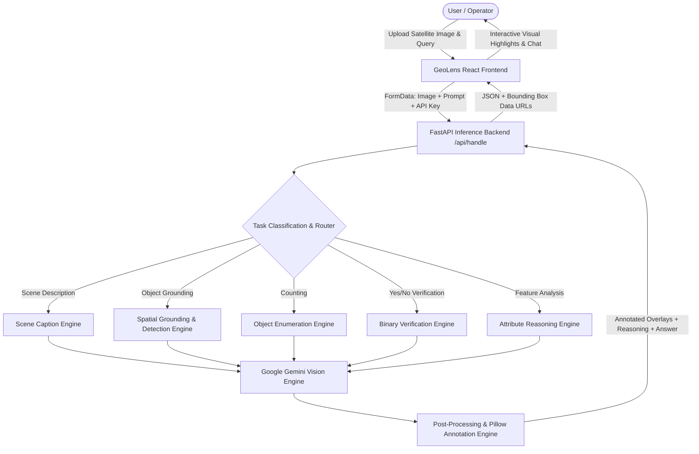

# GeoLens: Natural-Language Vision-Language Platform for Satellite Imagery 🛰️🌍

[](https://fastapi.tiangolo.com)
[](https://react.dev/)
[](https://aistudio.google.com/)
[](https://tailwindcss.com/)
[](LICENSE)

---

## 📌 Executive Summary

**GeoLens** is an advanced vision-language platform that enables users to upload high-resolution satellite imagery and interact with it using intuitive, natural-language queries. By integrating multimodal Vision-Language Models (VLMs) and geospatial segmentation pipelines, GeoLens performs visual question answering (VQA), object detection, spatial grounding, object enumeration, and deep scene interpretation.

> **Project Highlight**:  
> *"Developed a vision-language platform that enables users to upload satellite imagery and interact with it using natural-language queries. Integrated vision-language and segmentation models to perform visual question answering, object detection, grounding, and spatial localization of objects in satellite images. Built a FastAPI-based inference backend and React interface to generate AI-powered answers with visual highlights and detected-object information."*  
>  
> **Impact**:  
> *"Created a vision-language platform that empowers urban planners and researchers to instantly extract spatial insights from satellite imagery using simple, conversational queries."*

---

## 🎯 Key Capabilities

- 🔍 **Natural Language Grounding & Spatial Localization**:  
  Locate objects specified in natural language (e.g., *"Find all cargo ships near the docks"* or *"Locate aircraft on the eastern tarmac"*). Returns precise 2D bounding boxes and renders high-visibility overlays directly on the canvas.
  
- 🔢 **Intelligent Object Enumeration**:  
  Accurately counts satellite objects (buildings, storage tanks, vessels, airplanes, vehicles) while labeling each detected target and displaying the breakdown in real time.

- 💬 **Geospatial Visual Question Answering (VQA)**:
  - **Attribute Reasoning**: Analyzes surface texture, building density, roof materials, vegetation health, and terrain morphology.
  - **Binary Verification**: Answers True/False and Yes/No questions regarding terrain conditions and structural existence with visual evidence.
  - **Numerical Measurement**: Pixel-to-meter spatial scaling for distance and area estimations when spatial resolution metadata is available.

- 📝 **Automated Satellite Scene Captioning**:  
  Generates comprehensive technical remote sensing captions summarizing land use, sensor modality, transport networks, water bodies, and environmental cues.

- ⚡ **Google Gemini Vision Integration**:  
  Natively supports **Google Gemini 2.5 Flash, 2.0 Flash, and 1.5 Flash/Pro** models for instant zero-shot satellite analysis without requiring costly local GPU clusters. Users can configure API keys via `.env` or interactively inside the web UI.

- 🎨 **Interactive Mission-Control Canvas**:  
  Full-featured React 19 interface with pan, zoom (up to 5x), 90° rotation, horizontal flip, rectangular region cropping, and an interactive historical image gallery.

---

## 🏗️ Architecture & Pipeline Flow



---

## 🛠️ Technology Stack

| Layer | Technologies |
| :--- | :--- |
| **Frontend** | React 19, Vite, Tailwind CSS, Axios, Lucide/SVG Icons, Canvas Transformation Engine |
| **Backend API** | Python 3.10+, FastAPI, Uvicorn, HTTPX (Asynchronous HTTP/2), Pydantic |
| **Vision-Language (AI)** | Google Gemini Vision (`gemini-2.5-flash`, `gemini-2.0-flash`, `gemini-1.5-flash`, `gemini-1.5-pro`), Qwen3-VL |
| **Computer Vision** | Pillow (PIL), OpenCV Headless, Bounding Box Annotation, Spatial Scaling |
| **Segmentation / Local** | GroundingDINO, Segment Anything (SAM / SAM-3), LangChain & LangGraph compatibility |

---

## 📁 Repository Structure

```
GeoLens/
├── backend/                        # FastAPI Inference Backend
│   ├── api.py                      # Main API server with Gemini Vision & VQA router
│   ├── .env.example                # Template environment variables
│   ├── .env                        # Local configuration (API keys, models)
│   └── README.md                   # Backend documentation
├── frontend/                       # React 19 + Vite + Tailwind CSS Web Application
│   ├── src/
│   │   ├── App.jsx                 # Core mission-control interface & canvas logic
│   │   ├── main.jsx                # React DOM entrypoint
│   │   ├── index.css               # Tailwind CSS & global styles
│   │   └── GeoLens.svg             # GeoLens vector brand asset
│   ├── public/                     # Static production assets
│   │   └── GeoLens.svg             # Public brand logo & favicon
│   ├── package.json                # Frontend package configuration
│   └── vite.config.js              # Vite bundler configuration
├── vqa/                            # Core VQA reasoning & modular orchestrators
├── sam3_service/                   # Segment Anything (SAM-3) microservice
├── fine_tuning/                    # Training and parameter fine-tuning pipelines
├── docs/                           # Technical specifications and deployment guides
├── samples/                        # Sample satellite imagery for testing
├── start_geolens.bat               # 1-Click launcher for both Backend & Frontend
├── start_backend.bat               # Standalone backend start script
├── start_frontend.bat              # Standalone frontend start script
└── README.md                       # Main repository overview & guide
```

---

## 🚀 Quick Start Guide

### Prerequisites
1. **Python 3.10+** (Tested on Python 3.10 - 3.14)
2. **Node.js 18+** & **npm**
3. *(Recommended)* A free **Google Gemini API Key** from [Google AI Studio](https://aistudio.google.com/)

---

### Option A: One-Click Startup (Windows)
Double-click:
```cmd
start_geolens.bat
```
This automatically launches the FastAPI backend and Vite frontend development server in dedicated terminal windows.

---

### Option B: Manual Startup

#### 1. Start the Backend
```bash
# Navigate to backend directory
cd backend

# Install Python requirements
pip install fastapi uvicorn httpx pillow python-dotenv python-multipart

# Configure your Gemini API Key in .env
# (Copy .env.example if .env does not exist)
# Edit .env: GEMINI_API_KEY=your_actual_key_here

# Run the backend server
python -m uvicorn api:app --host 0.0.0.0 --port 8000 --reload
```
- API Endpoint: `http://localhost:8000`
- Interactive Swagger Documentation: `http://localhost:8000/docs`

#### 2. Start the Frontend
```bash
# Open a new terminal and navigate to frontend directory
cd frontend

# Install dependencies
npm install

# Start the Vite development server
npm run dev
```
- Web Application: `http://localhost:5173`

---

## ⚙️ Configuring Google Gemini Vision

You can set your Gemini API key in two convenient ways:

1. **In Backend Environment (`.env`)**:
   Add to `backend/.env`:
   ```env
   API_MODE=gemini
   GEMINI_API_KEY=AIzaSy...your_gemini_key
   GEMINI_MODEL=gemini-2.5-flash
   ```

2. **Directly in the Web Interface**:
   - Open GeoLens at `http://localhost:5173`.
   - Click the **Gemini Engine** button in the left sidebar footer.
   - Enter your Gemini API Key and select your preferred model (`gemini-2.5-flash`, `gemini-2.0-flash`, `gemini-1.5-flash`, or `gemini-1.5-pro`).
   - Click **Save Configuration**. Your key is securely saved in your browser's local storage and used for subsequent queries.

---

## 🧪 Example Queries to Try

Once you upload any satellite image from `samples/`:
- **Scene Captioning**: *"Generate a detailed geospatial caption for this satellite imagery."*
- **Object Grounding**: *"Find and highlight all airplanes on the runway."* or *"Locate all ships docked at the harbor."*
- **Counting**: *"How many storage tanks are visible in the industrial sector?"*
- **Binary Verification**: *"Is there a bridge connecting the two riverbanks?"*
- **Attribute Analysis**: *"What type of terrain and vegetation density is present in the northwest quadrant?"*

---

## 📄 License
This project is licensed under the MIT License.
